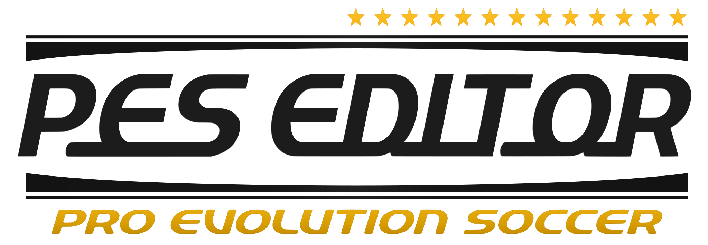
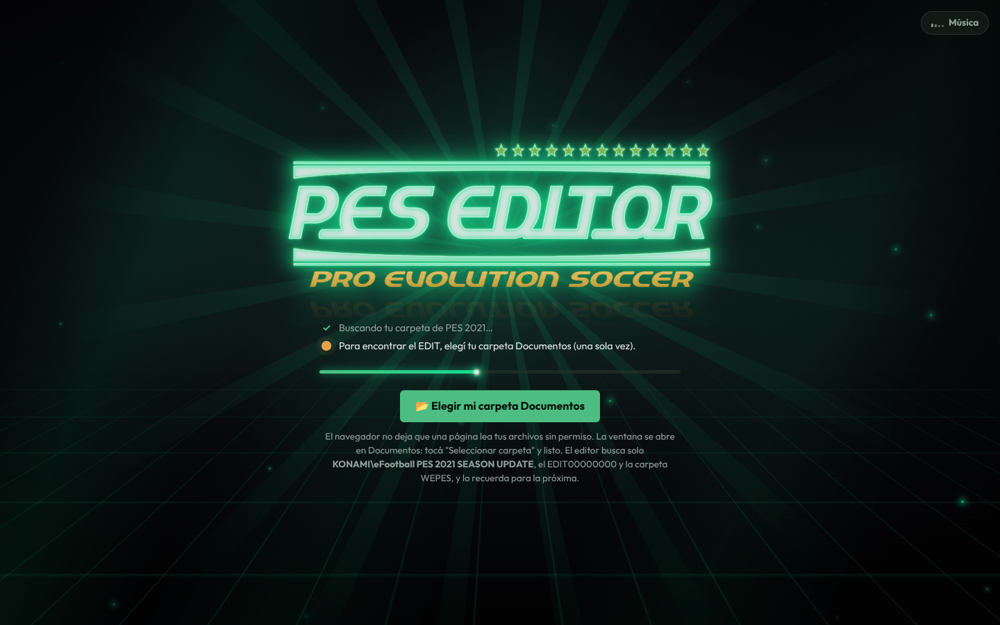
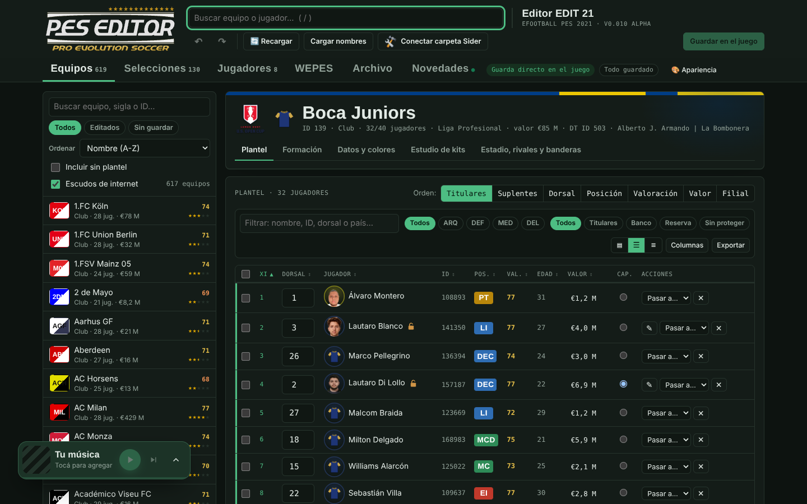
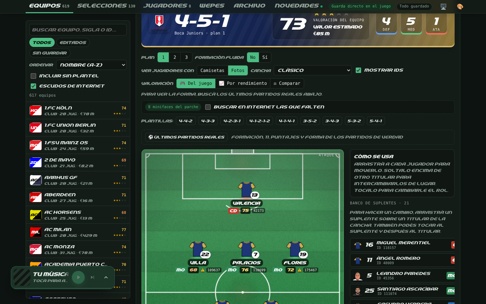
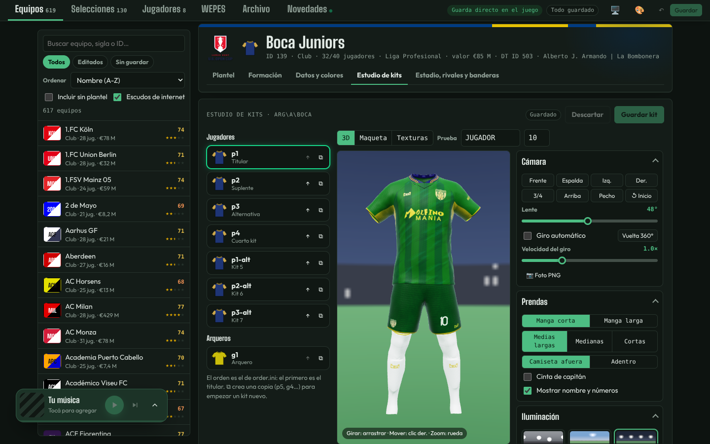
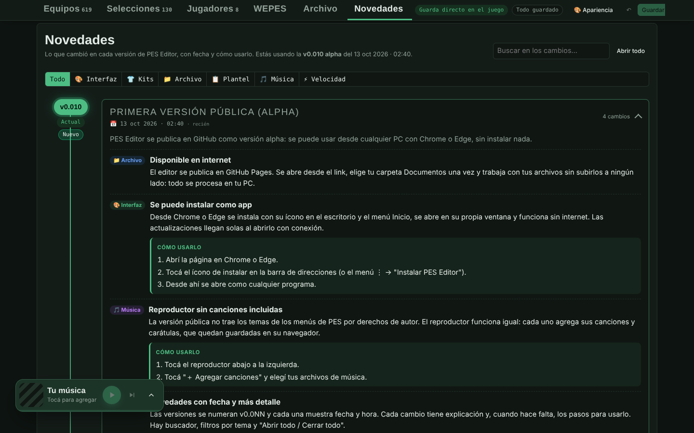
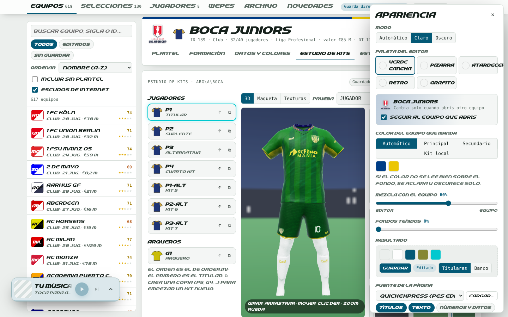
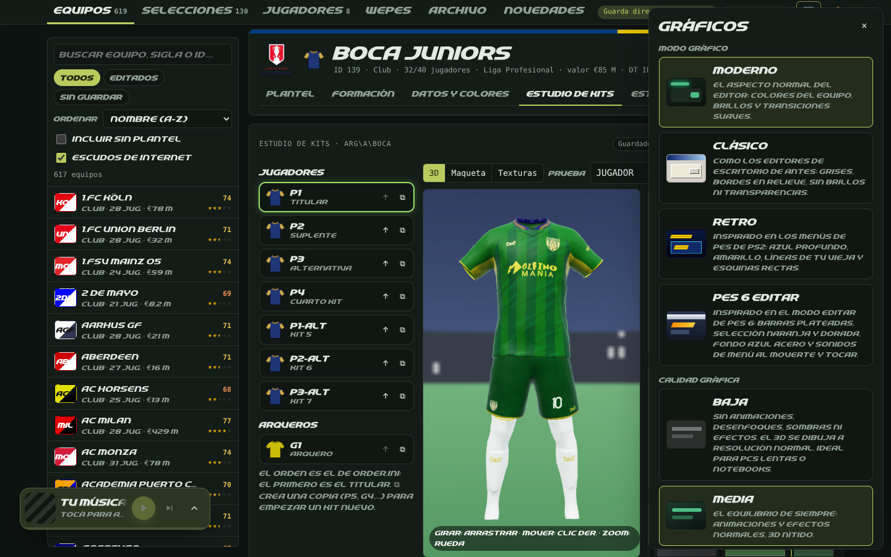
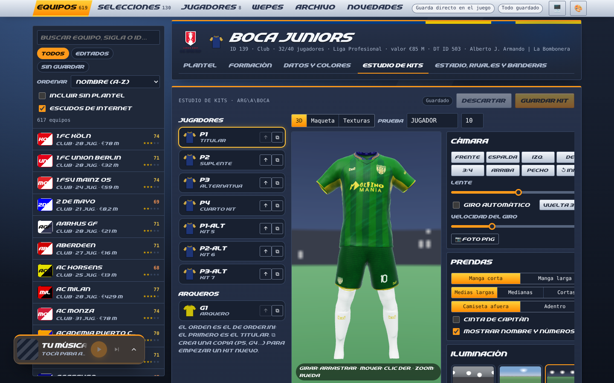
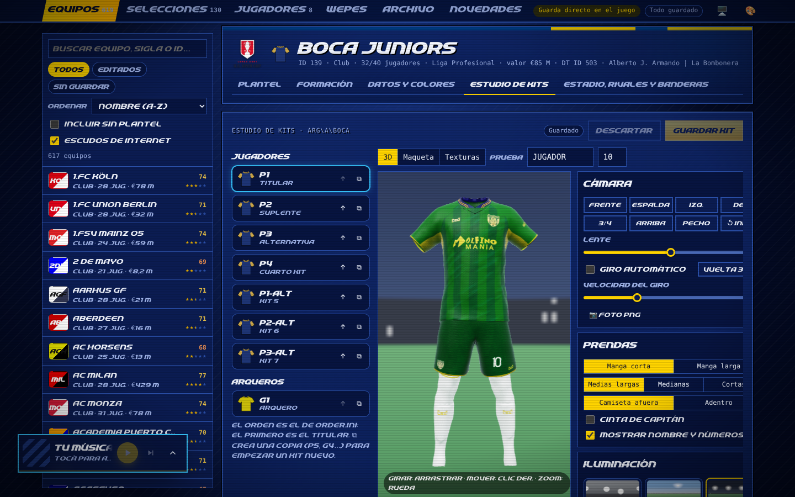

<picture>
  <source media="(prefers-color-scheme: dark)" srcset="assets/logo-oscuro.svg">
  <source media="(prefers-color-scheme: light)" srcset="assets/logo-claro.svg">
  
</picture>

### Un PES Editor renovado

*Hecho por un fanático del PES para los que todavía arman su Liga Master a mano.* ⚽

Editor del archivo **EDIT00000000** de **eFootball PES 2021** con Sider , directo en el navegador.

**[▶ Abrir PES Editor Rebuilt](https://agustinioquino.github.io/Pes-Editor-Rebuilt/)** · **[⬇️ Descargar para Windows (.exe)](https://github.com/Agustinioquino/Pes-Editor-Rebuilt/releases/download/v0.045-alpha/PES-Editor-Rebuilt-Setup.exe)** · [📦 Portátil](https://github.com/Agustinioquino/Pes-Editor-Rebuilt/releases/download/v0.045-alpha/PES-Editor-Rebuilt-Portable.exe)

La app para Windows es el mismo editor en su propia ventana: se actualiza sola y conecta la carpeta Sider aunque esté en Archivos de programa. <a href="#-con-la-app-para-windows">Cómo instalarla</a>

## 🧉 ¿Por qué existe?

Porque editar el PES siempre fue parte del juego: corregir planteles, cambiar el dorsal de tu ídolo, armar la camiseta del club del barrio. Las herramientas de siempre hacen el trabajo, pero se quedaron en el tiempo. **PES Editor Rebuilt** junta todo en un solo lugar, con una interfaz moderna, el Kit Studio Pro en 3D y, para los nostálgicos, música de menú de fondo mientras editás.

> [!WARNING]
> **Versión alpha.** Funciona y guarda en el juego, pero todavía puede tener errores. El editor hace una copia de respaldo del EDIT cada vez que guardás. Igual, conviene tener tu propia copia antes de empezar.

## ✨ Características

### 📁 Archivo y carpeta del juego
- **Encuentra el EDIT solo.** Busca `KONAMI\eFootball PES 2021 SEASON UPDATE` en tu carpeta Documentos y abre el `EDIT00000000` más reciente (primero el de la carpeta `drmp`).
- **También como programa para Windows.** [PES Editor Rebuilt para Windows](https://github.com/Agustinioquino/Pes-Editor-Rebuilt/releases/download/v0.045-alpha/PES-Editor-Rebuilt-Setup.exe) es el mismo editor en su propia ventana, y conecta la carpeta Sider aunque esté dentro de `C:\Program Files (x86)`, donde Chrome y Edge no dejan escribir. Se actualiza solo, igual que la página.
- **Elegís la carpeta una sola vez.** Con "Permitir en cada visita", las veces siguientes entra directo.
- **Varios EDIT.** En *Archivo* se ven todos los EDIT encontrados (`drmp`, `save`, otras cuentas de Steam) y podés cambiar de uno a otro.
- **Guarda directo en el juego.** Hace una copia de respaldo del archivo anterior antes de cada guardado.
- **Detecta cambios del juego.** Si el juego guardó el EDIT mientras el editor estaba abierto, lo recarga para que veas lo mismo que el juego.
- **Deshacer y rehacer** (Ctrl+Z / Ctrl+Y) para cualquier cambio.
- **Instala solo el módulo de Sider.** Al tocar *Conectar carpeta Sider*, el editor copia `edit21_db.lua` en `modules\` y lo suma a `sider.ini` si falta (con copia de respaldo del ini). Ese módulo es de solo lectura: cuando abrís el juego, guarda una copia de la base del juego para que el editor tenga nombres, equipos y planteles completos.
- **Avisa si la base no está cargada** y explica qué hacer: abrir el juego hasta el menú principal, entrar en *Partido › Amistoso* hasta la elección de equipos y cerrar. Si Windows no dejó escribir la copia, muestra el error que quedó en `sider.log` y cómo resolverlo.
- **Pestaña WEPES.** Muestra los archivos de esa carpeta con miniaturas (png, jpg, dds, ftex), deja entrar a subcarpetas, ver en grande y copiar archivos nuevos.

### 📋 Equipos, plantel y formación
- **Lista de equipos.** Búsqueda, filtros (editados, sin guardar), orden, valoración y valor estimado.
- **Buscador global** para encontrar cualquier equipo o jugador (tecla `/`).
- **Plantel como tabla de datos:**
  - ordenar por columna;
  - filtrar por texto, posición y situación (titulares, banco, reserva);
  - acciones sobre varios jugadores a la vez (incluida la **equipación**: mangas, medias, guantes, botines…), y el **capitán** se elige desde el menú *Acciones* de cada jugador (queda marcado con una **C**);
  - columnas a elección, tres densidades y exportar.
- **Fotos de los jugadores** (minicaras del juego) en el plantel y la formación.
- **Formación sobre la cancha:**
  - arrastrás jugadores para moverlos o intercambiarlos;
  - plantillas de formación y tres planes;
  - banco de suplentes;
  - valoración del equipo.
- **Estrategia como en el Plan de juego.** Las mismas opciones y nombres que el juego, cada una con su explicación; las 4 instrucciones avanzadas (2 de ataque y 2 de defensa); las opciones tácticas rápidas y la Config. marcaje.
- **Capitán y balón parado.** Tiros libres, córners, penales y los 3 jugadores ofensivos, a mano o automático según las habilidades.
- **Valoración por rendimiento.** Usa los últimos partidos reales; los cambios se ven con una animación al aplicarlos.
- **Plantel según la base del juego.** Si un equipo está vacío en tu EDIT, se ve el plantel que trae el juego y se puede copiar al EDIT con un toque (se deshace con Ctrl+Z).
- **Todos los jugadores del juego en *Jugadores*.** Con la base copiada, la pestaña muestra los más de 27.000 jugadores del juego además de los de tu EDIT: búsqueda por nombre, ID o equipo, ficha con cara, equipos, dorsal y todas las habilidades, y un botón para agregarlo a tu EDIT y editarlo.
- **Selecciones nacionales.** Convocatorias con los jugadores de cada país.
- **Datos, colores, estadio, rivales y banderas** de cada equipo.

### 👕 Kit Studio Pro (kit-server de Sider)
- **Visor 3D con los modelos reales:**
  - camisetas, mangas, más de 100 cuellos, 16 shorts y medias;
  - iluminación tipo estadio y fondo HDRI propio;
  - vistas de cámara fijas y giro automático.
- **Edición visual del `config.txt`:**
  - cuello, short, colores, posición de nombre y números;
  - vista plana (maqueta) para acomodar los números arrastrando.
- **Dos partes:** Uniformes (todos los kits del equipo con sus texturas, orden, copias y borrado) y Editor (un kit a pantalla ancha).
- **Cargar un kit desde un .zip.** Se arrastra a Uniformes, se elige el puesto (titular, suplente, tercera, cuarta o arquero), se avisa si el puesto ya tiene kit (reemplazar o agregar como nuevo), se convierte todo a FTEX, se generan genéricos el normal map, el brillo y las letras que falten, y se escriben el config.txt y el order.ini. Si el equipo no tiene carpeta en el kit-server (sus kits están en los .cpk), se le crea una y se anota en map.txt.
- **Subir texturas al kit-server.** Kit, normal map y fuentes (nombre, espalda, pecho, short). Se convierten al formato del juego (FTEX) con copia de respaldo.
- **Brillo del kit.** El canal alfa de la textura marca cuánto brilla cada zona: se ve en el 3D y se puede pintar.
- **Tela y relieve.** Ocho tipos de tela y un generador de normal map que el juego aplica.
- **Generador de fuentes** para nombres y números, con bordes y sombra, respetando las plantillas del juego.

### 🎨 Interfaz
- **Apariencia:**
  - modo claro u oscuro;
  - paletas, con mezcla de colores con los del equipo abierto;
  - esquinas y tamaño de letra;
  - fuente propia para toda la página.
- **Una fuente para cada estilo:** *Outfit* y *Big Shoulders* en Moderno (modernas y legibles), *QuickExpress* en PES 6 Editar, letras de píxeles *Pixelify Sans* y *Silkscreen* en Retro (en la onda de los Winning Eleven de PS1) y *Tahoma* en Clásico. Se puede cambiar en cada estilo desde Apariencia y funcionan sin internet.
- **🖥️ Gráficos:**
  - modos *Moderno*, *Clásico* (editor de escritorio de antes), *Retro* (menús de PS2) y **PES 6 Editar**, inspirado en el menú Editar de PES 6: barras plateadas, selección amarilla dorada y fondo ámbar desenfocado;
  - sonidos de *confirmar* y *deshacer* del menú de PES 6 al tocar opciones y al volver;
  - con Clásico, Retro o PES 6, Apariencia deja ajustar solo tamaño de letra, fuente y efectos;
  - calidad *Baja* (sin animaciones ni efectos, para PCs lentas), *Media* o *Alta* (3D con supermuestreo y efectos al máximo).
- **Intro animada** con el logo y brillo neón mientras carga el EDIT.
- **Reproductor de música** abajo a la izquierda:
  - carátula, aleatorio, repetir y volumen;
  - pases entre canciones *Corte*, *Suave* o *Remix* (filtros y eco estilo DJ);
  - agregás tus canciones y el editor lee **título, artista y carátula** de sus etiquetas (MP3, FLAC, M4A);
  - **listas y videos de YouTube** pegando el link (con el reproductor minimizado, el video va arriba de la barra si hay espacio libre a la izquierda; si no, al costado).
- **Novedades.** Cada cambio con fecha, explicación y pasos para usarlo.
- **Instalable como app** desde Chrome o Edge, con su ícono y funcionamiento sin internet.

## 📸 Capturas

| Plantel | Formación |
|---|---|
|  |  |
| **Kit Studio Pro** | **Novedades** |
|  |  |
| **Apariencia (modo claro)** | **Gráficos** |
|  |  |
| **Estilo PES 6 Editar** | **Estilo Retro** |
|  |  |

## 🚀 Cómo usarlo

Hay dos formas de usar el mismo editor: en el navegador o con la app para Windows. Si tu carpeta Sider está dentro de `C:\Program Files (x86)` (donde Steam instala PES 2021), usá la app, porque el navegador no deja guardar ahí.

### 🌐 En el navegador

1. Abrí **[PES Editor Rebuilt](https://agustinioquino.github.io/Pes-Editor-Rebuilt/)** en **Chrome** o **Edge**. Firefox y Safari todavía no permiten que una página lea carpetas.
2. Tocá **"📂 Elegir mi carpeta Documentos"** y después *Seleccionar carpeta*.
3. En el aviso del navegador elegí **"Permitir en cada visita"** para no repetir el paso.
4. **Tocá "Conectar carpeta Sider"** y elegí la carpeta de Sider del juego (la que tiene `sider.exe`, dentro de la carpeta del juego). Con eso se cargan los **nombres de los jugadores, sus valoraciones y valores**, las caras, los escudos y los kits. Se elige una sola vez.
5. **La primera vez, prepará la base del juego.** El editor instala el módulo `edit21_db.lua` en Sider y te avisa. Abrí PES 2021 con Sider hasta el **menú principal**, entrá en **Partido › Amistoso** hasta la **elección de equipos** y cerrá el juego. Volvé al editor y tocá **"Ya lo hice"**.
6. Editá y tocá **"Guardar en el juego"**. Cerrá el juego antes de guardar.

> [!TIP]
> **¿No ves nombres de jugadores ni valoraciones?** Si en el plantel aparece *"sin nombre · conectá la carpeta Sider"* o las columnas de valoración y valor están vacías, falta el paso 4: tocá **"Conectar carpeta Sider"** arriba y elegí la carpeta de Sider. El EDIT solo guarda tus cambios; los datos completos de cada jugador vienen de la base del juego. Si ya la habías conectado y el navegador te pide permiso de nuevo, tocá **"Permitir"**.
>
> **¿El aviso de la base no se va?** Mirá el `sider.log` en la carpeta de Sider y buscá las líneas `[edit21_db]`. Si dice `copiado ...`, la copia se hizo: tocá **"Ya lo hice"**. Si dice `ERROR no puedo escribir ... -> nil`, es el `io` de Sider, que en algunas instalaciones no deja guardar archivos: desde la v1.5 el módulo lo resuelve solo escribiendo con las funciones de Windows, siempre que `sider.ini` tenga `luajit.ext.enabled = 1` (el juego ya lo trae). Si el error dice *Permission denied*, revisá **Seguridad de Windows › Protección contra ransomware › Acceso controlado a carpetas** y permití `PES2021.exe`.

**Instalarlo desde el navegador:** en Chrome o Edge tocá el ícono de instalar en la barra de direcciones (o menú ⋮ → *Instalar PES Editor Rebuilt*). Para conectar una carpeta Sider que está en Archivos de programa hace falta la app para Windows.

### 💻 Con la app para Windows

1. Descargá el **[instalador (.exe)](https://github.com/Agustinioquino/Pes-Editor-Rebuilt/releases/download/v0.045-alpha/PES-Editor-Rebuilt-Setup.exe)** o la **[versión portátil](https://github.com/Agustinioquino/Pes-Editor-Rebuilt/releases/download/v0.045-alpha/PES-Editor-Rebuilt-Portable.exe)**, que se abre sin instalar nada.
2. Si Windows muestra **"Windows protegió su PC"**, tocá **Más información › Ejecutar de todas formas**.
3. Abrí **PES Editor Rebuilt**, tocá **"📂 Elegir mi carpeta Documentos"** y después **"Conectar carpeta Sider"**. La carpeta Sider se conecta donde está, aunque sea dentro de Archivos de programa, con permiso para guardar.
4. Seguí con los pasos 5 y 6 de arriba: la base del juego y **"Guardar en el juego"**.

> [!NOTE]
> **Se actualiza sola.** La app abre el editor desde su página web cada vez que arranca, así que todo lo nuevo (el editor, la valoración, la interfaz, el caché) le llega igual que a la web, sin reinstalar. Solo hace falta bajar un .exe nuevo cuando cambia la app en sí: el logo, el nombre o cómo accede a tus carpetas. Pasa muy de vez en cuando, y ahí instalás el nuevo encima.
>
> **¿Por qué aparece "Windows protegió su PC"?** La app todavía no tiene firma digital, que es un certificado que le dice a Windows quién hizo el programa. Sin ella Windows avisa la primera vez, pero la app funciona igual. El código y el armado del .exe están a la vista en este repositorio ([`desktop/`](desktop/)).
>
> **¿No deja guardar?** Si Windows no deja escribir en una carpeta, la app te avisa: cerrala y abrila con clic derecho › *Ejecutar como administrador*. Si el juego tiene un archivo abierto, te pide que lo cierres.

🇬🇧 The Windows app in English

**PES Editor Rebuilt for Windows** is the same editor as the web page, in its own window. It connects your Sider folder where it is, even inside `C:\Program Files (x86)`, where the browser can't save.

1. Download the **[installer (.exe)](https://github.com/Agustinioquino/Pes-Editor-Rebuilt/releases/download/v0.045-alpha/PES-Editor-Rebuilt-Setup.exe)** or the **[portable version](https://github.com/Agustinioquino/Pes-Editor-Rebuilt/releases/download/v0.045-alpha/PES-Editor-Rebuilt-Portable.exe)**, which runs without installing.
2. If Windows shows **"Windows protected your PC"**, click **More info › Run anyway**.
3. Open **PES Editor Rebuilt**, click **"📂 Pick my Documents folder"** and then **"Connect Sider folder"**.
4. Then follow steps 5 and 6 above: the game database and **"Save to the game"**.

**It updates itself.** The app loads the editor from its web page every time it starts, so every change reaches it just like the web, without reinstalling. You only need a new .exe when the app itself changes (the logo, the name or how it reaches your folders); install it over the old one.

**Why "Windows protected your PC"?** The app has no digital signature yet, a paid certificate that tells Windows who made the program. Without it Windows warns you the first time, but the app works the same.

**Privacidad:** en el navegador y en la app, todo se procesa en tu PC. Tus archivos no se suben a ningún servidor.

## 🎵 Música

Por derechos de autor, el repositorio **no incluye** música de los juegos. El reproductor funciona igual:

- **＋ Agregar canciones:** elegís archivos de tu PC y se suman con su carátula.
- **▶ YouTube:** pegás el link de una lista o un video. YouTube no permite ocultar sus videos, así que se ven chiquitos arriba del reproductor (o en lugar de la carátula, con el panel abierto).

Todo queda guardado en tu navegador.

## 🗺️ Próximas actualizaciones

PES Editor sigue en desarrollo. Esto es lo que viene (puede cambiar):

- Más opciones en el Kit Studio Pro y en la edición de estadios.
- Mejoras en la versión instalable (accesos directos, funcionamiento sin conexión más completo).
- Correcciones a partir de lo que reporten los usuarios.

Para enterarte de cada versión, tocá **Watch → Custom → Releases** arriba en este repositorio. Dentro del editor, la pestaña **Novedades** muestra un punto cuando hay algo nuevo.

¿Encontraste un error o se te ocurrió algo? Abrí un [issue](https://github.com/Agustinioquino/Pes-Editor-Rebuilt/issues/new/choose): hay una plantilla para **🐛 Algo no anda** y otra para **💡 Tengo una idea**. Todo suma, como un buen pase al vacío.

## 🧩 Cómo está armado el código

Todo es HTML, CSS y JavaScript sin frameworks ni instalación. `index.html` es corto: carga `css/editor.css` y los archivos de la carpeta `js/`, uno por cada parte del editor, en este orden:

| Archivo | Qué hace |
|---|---|
| `pescrypt.js`, `pesdata.js` | Descifra el EDIT00000000 y lee/escribe equipos, jugadores y tácticas |
| `tables.js`, `dds.js`, `faces.js`, `pitch.js` | Tablas del juego, imágenes DDS, minicaras y escudos, dibujo de la cancha |
| `extras.js`, `matches.js`, `natcall.js` | Formación, valoración por rendimiento, convocatorias de selecciones |
| `ftexenc.js`, `kitfont.js`, `kitmat.js`, `kitstudio.js`, `kitpack.js`, `kit3d.js` | Kit Studio Pro: texturas FTEX, fuentes, telas, modelos y visor 3D |
| `luadata.js`, `siderdb.js` | Módulo de Sider `edit21_db.lua` (se instala solo) y lectura de la base del juego |
| `intro.js`, `news.js`, `help.js` | Pantalla de carga, Novedades y ayudas |
| `app.js`, `motion.js`, `ui.js`, `gfx.js` | La página en sí, animaciones, Apariencia y Gráficos |
| `fonts.js`, `logos.js`, `sfxdata.js` | Fuentes, logos y sonidos incluidos |
| `mptags.js`, `music.js`, `mpyt.js` | Reproductor: etiquetas de canciones, audio y YouTube |

Para probar un cambio alcanza con editar el archivo y recargar la página.

## 🙌 Créditos e inspiración

Este proyecto toma inspiración de **PES 2020 Editor**, la herramienta original creada por **[ejogc327](https://ejogc327.blogspot.com/2022/10/pes-2020-editor-v0-12.html)**. Gracias por abrir el camino.

Los modelos 3D de los kits se basan en el *CometKIT previewer*. Las plantillas de fuentes siguen el formato del juego. Fuentes: *QuickExpress* (reparada y ampliada con letras del español) y, con licencia libre SIL OFL, *Outfit*, *Big Shoulders*, *Pixelify Sans* y *Silkscreen*. El estilo *PES 6 Editar* es un homenaje: el diseño está hecho a mano, sin imágenes del juego, y usa dos sonidos cortos de su menú (confirmar y deshacer).

## 📄 Licencia

Código bajo licencia [BSD 3-Clause](LICENSE).

---

Hecho con ❤️ y mate en Argentina 🇦🇷

PES Editor es un proyecto de fans sin relación con Konami. *eFootball* y *Pro Evolution Soccer* son marcas de Konami Digital Entertainment. Usalo bajo tu responsabilidad y guardá copias de tus archivos.
